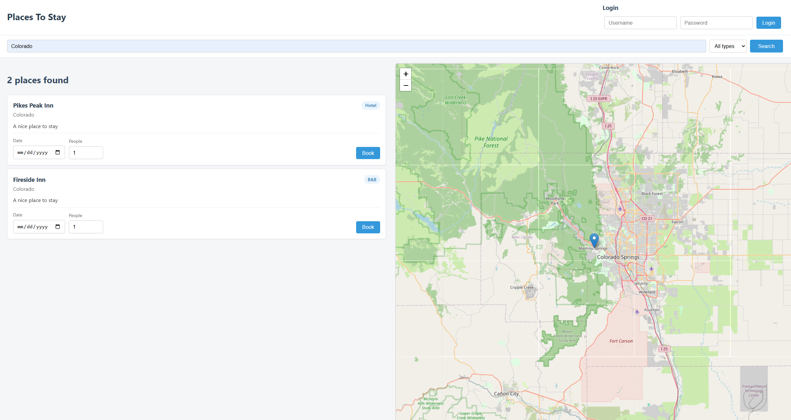
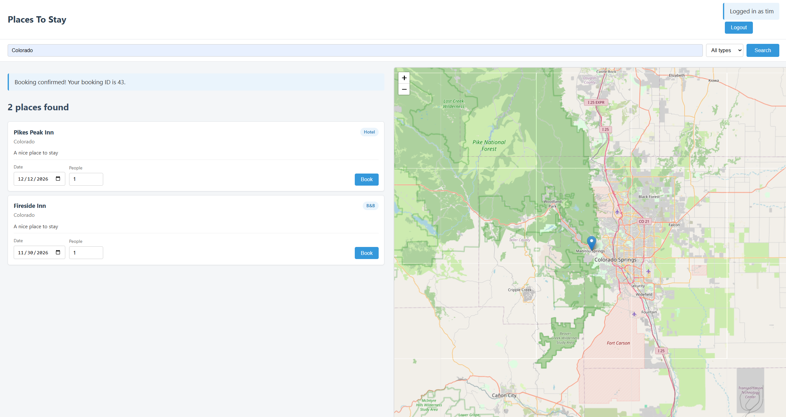

# PlacesToStay

PlacesToStay is a full stack web app for finding and booking accommodation. You search for a place by location and type, see the results as cards next to a map, log in, and book a date. I built it as a university project (COM518) and then improved it afterwards.

## What it does

* Search accommodation by location, and filter by type (hotel, B&B, pub or campsite).
* Shows the results as cards on the left and as markers on a Leaflet map on the right.
* Log in and log out with a username and password.
* Book a place for a chosen date and number of people. You must be logged in to book.
* Checks every booking on the server: the date must be in the future, the number of people must be a whole number above zero, and there must be enough space left on that date.
* Takes the booked spaces off that date's availability, and returns a booking ID as confirmation.

## Built with

* **Frontend:** React, TypeScript, Leaflet, CSS
* **Backend:** Node.js, Express, TypeScript
* **Database:** SQLite, using better-sqlite3
* **Login:** express-session with a SQLite session store, and bcrypt for password hashing
* **Tooling:** Vite (through vite-express), tsx, Prettier

## How to run it

You need Node.js 20.19 or newer.

1. Install the packages:
   ```
   npm install
   ```
   If npm says some install scripts were blocked (bcrypt, better-sqlite3, esbuild), approve them and rebuild:
   ```
   npm install-scripts approve bcrypt better-sqlite3 esbuild
   npm rebuild
   ```
2. Create a file called `.env` in the project folder and add a session secret. Copy `.env.example` and change the value to your own long random text:
   ```
   SESSION_SECRET=your-own-long-random-text
   ```
3. Add bookable dates. The sample data only has old dates, so this adds the next 90 days for every place. It is safe to run again later.
   ```
   npm run seed
   ```
4. Start the app:
   ```
   npm run dev
   ```
5. Open http://localhost:3000

### Demo accounts

These are sample accounts for testing only.

| Username | Password |
|----------|----------|
| tim      | tim123   |
| tina     | tina123  |

## How it works

The server has three groups of routes:

| Method | Route | What it does | Login needed |
|--------|-------|--------------|--------------|
| GET | `/accommodation/:location` | Find places in a location | No |
| GET | `/accommodation/:location/:type` | Find places in a location of one type | No |
| POST | `/accommodation/book` | Book a place for a date | Yes |
| GET | `/login` | Check who is logged in | No |
| POST | `/login` | Log in | No |
| POST | `/logout` | Log out | No |

The database has four tables: `accommodation`, `acc_dates` (how many spaces are free on each date), `acc_bookings` and `acc_users`.

### Decisions I made

* **The server decides who is booking.** After login, the user ID is stored in the server session. The booking route reads it from there and ignores any user ID sent by the browser, so one user cannot book as another.
* **A booking is all or nothing.** Saving the booking and reducing the availability happen in one database transaction. If there is not enough space, nothing is saved.
* **Secrets stay out of the code.** The session secret is read from a `.env` file, which is not committed to Git.
* **Safer database code.** All queries use parameters, and text from users is cleaned before it is used.

## Project structure

```
controllers/   Request handling and validation
dao/           Database queries
routes/        Route definitions
middleware/    Login check for booking routes
src/           React frontend
seed.ts        Adds bookable dates and cleans bad data
```

## Current limits

This is a student project, and these things are not done yet:

* Location search must match exactly, including capital letters. For example, `Hampshire` works but `hampshire` does not.
* The data has no prices or photos, so the cards do not show them.
* There is no sign up page. Users have to already exist in the database.
* You cannot see or cancel your bookings after making one.
* There are no automated tests yet. I have tested the booking route by hand.
* Sessions end after 10 minutes without activity.

## Screenshots




